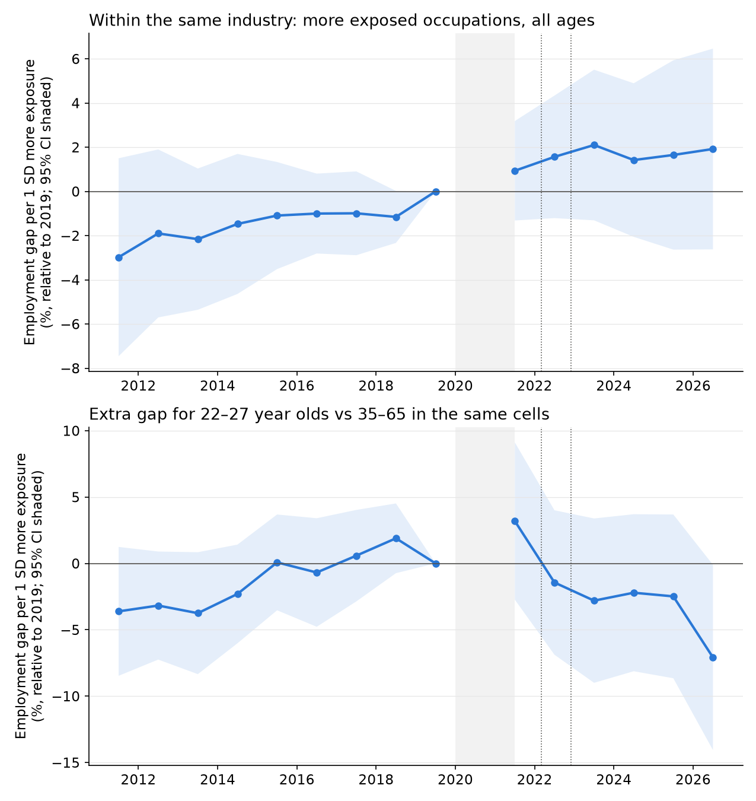
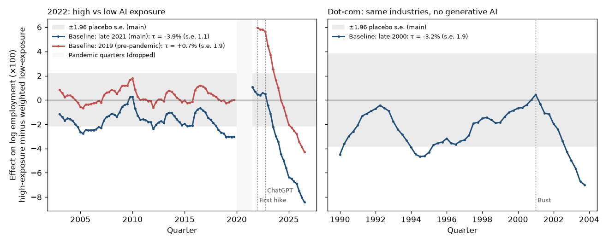
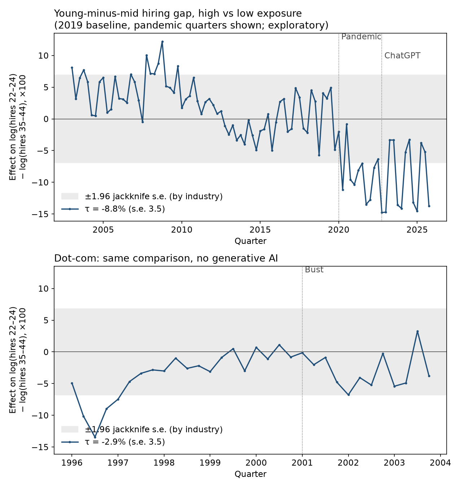

# AI Exposure and U.S. Employment After 2022

**A note before you read:** this is a side project I did in my free time, out of genuine curiosity. I'm not an economist
or a labor-market specialist, and it hasn't been peer reviewed. I kept hearing confident claims about AI and jobs and wanted
to see what public data, and what I know about causal inference, could actually show. I've tried to be upfront about where
it falls short. If you find something I got wrong, I'd like to hear it.

Tech job postings fell hard after 2022. The popular story says AI did it. The competing story
says the end of near-zero interest rates, a pandemic hiring binge and a tax change did it, and
ChatGPT just happened to arrive at the same time. Truth is, nobody knows, me included. What I
know is data, so I used public labor-market data and quasi-experimental methods to see what it
can tell us.

**[Read the paper (PDF)](paper/ai_or_interest_rates.pdf)**, written for a general reader, or the
**[technical version (PDF)](paper/ai_or_interest_rates_technical.pdf)**, which has every table, equation and reference.
This README is the guide to the code and data behind them.

**Check the numbers yourself.** `pip install -r requirements.txt`, then `python -m pytest tests` checks the estimates
reported in the papers, the README and the scorecard against the saved results, with no data download needed. To rerun
everything from raw data, get a free IPUMS CPS extract ([recipe](docs/IPUMS_EXTRACT.md)) and run `python scripts/run_all.py`
(about 90 minutes); [section 11](#11-how-to-reproduce-it) has the details.

[](https://github.com/pbuszka1/ai-or-interest-rates/actions/workflows/tests.yml)
[](LICENSE)

**Scope.** This project measures total employment across occupations and private industries, compared
by potential AI exposure. It doesn't measure tech hiring directly, actual AI use, or how many jobs AI
added or removed in total. The paper's "What this does and doesn't measure" section sets out these boundaries.

## Contents

1. [The answer](#1-the-answer) (read this if you read nothing else)
2. [Where to find things](#2-where-to-find-things)
3. [The question, and why the obvious answer is shaky](#3-the-question-and-why-the-obvious-answer-is-shaky)
4. [What's already known](#4-whats-already-known)
5. [The data, and why each source](#5-the-data-and-why-each-source)
6. [The method, and why each piece](#6-the-method-and-why-each-piece)
7. [How I decide what counts as a real result](#7-how-i-decide-what-counts-as-a-real-result)
8. [Results in detail](#8-results-in-detail)
9. [What this does not show](#9-what-this-does-not-show)
10. [Potential areas of future work](#10-potential-areas-of-future-work)
11. [How to reproduce it](#11-how-to-reproduce-it)
12. [How this was built (and how AI was used)](#12-how-this-was-built-and-how-ai-was-used)
13. [Corrections](#13-corrections)
14. [Data licenses and sources](#14-data-licenses-and-sources)

---

## 1. The answer

> **Revised 2026-11-03: the headline verdict changed twice.** On 2026-11-02 a referee review found that Test A
> had used a 2020–25 occupation mix instead of the pre-registered 2015–19 mix. Correcting it turned a narrow
> pre-trend fail into a narrow pass and the verdict into "no effect larger than about 8% so far." An audit the next
> day found two errors in how CES industries were matched to occupation data. With both fixed, Test A is −5.0% and
> fails its pre-trend check (p = 0.073), so the verdict is back to "can't tell yet." Across six versions of the
> industry score that pre-trend p-value runs from 0.067 to 0.107, so read the estimates, not the label. Details are
> in [Corrections](#13-corrections).

*Results as of 2026-11-03, data through September 2026.*

**Short answer: can't tell yet. Inside the same industry, AI-exposed jobs haven't lost ground. Across
industries, more exposed ones slid about 5%, but that design fails its own pre-trend check and about 40% of the
slide runs through the pandemic boom. The thing to watch is young workers.**

| Question | Estimate (top vs bottom AI-exposure quartile) | Passed its own checks? | How I read it |
|---|---|---|---|
| **Inside the same industry**, do AI-exposed jobs lose ground? (Test B) | **+0.3%**, 95% CI −5.6% to +6.1% | Yes | A bounded null. Its interval rules out average shifts bigger than about 6%. |
| **Across industries**, do more exposed ones do worse? (Test A) | −5.0%, CI −9.0% to −0.9% | No (pre-trend p = 0.073, bar is 0.10) | Negative, and it would clear the correction for two main tests, but a failed pre-trend means the rules don't interpret it. About 40% runs through the pandemic boom. Weighted by employment: −5.5% (CI −9.0% to −2.1%). |
| **Young workers' hires** in exposed industries, ages 22–24 (QWI) | −9.3%, CI −18.3% to −0.2% | Yes | Real, but it started in 2020–21, before ChatGPT. |
| **Young workers' employment**, same occupation and industry (CPS) | −6.3%, CI −15.5% to +2.9%, p = 0.18, 91% probability below zero | Yes | Same direction as the Stanford study, but comparing young and older workers only within the same cells gives −0.9%. One partial year of noisy data. Not conclusive. |

**Overall verdict: "can't tell yet"** (the pre-registered rule, Verdict 4). Test B passes and shows no
change; Test A fails its pre-trend check, and Verdict 3 needs both to pass. The label sits on a test near its
threshold (p from 0.067 to 0.107 across versions of the industry score), while the estimates barely move
(−3.7% to −5.0%), so the estimates are the better guide. None of this says "AI has no effect."

**How sensitive these tests are:** Test A can reliably detect a gradual effect reaching about 8% by the
last quarter of data. Test B's interval bounds the average shift at about 6%, but using its actual
standard error, it needs a gradual effect reaching about 13% for 80% power. The age comparisons need roughly 13% to 24%, depending on the design, to see one, so a smaller hit to
young workers could be missed.



*Test B, yearly estimates relative to 2019 (shaded band = 95% CI; grey bar = dropped pandemic
years; dotted lines = Mar 2022 rate hikes and ChatGPT). **Top:** exposed vs less exposed
occupations in the same industry, all ages. After 2022 the estimate sits at about +1% to +2%
per standard deviation of exposure, and the band includes zero throughout: no loss. **Bottom:**
the extra gap for 22–27 year olds vs 35–65 in the same cells. It drifts down after 2022 and
drops in 2026, but the band is wide and 2026 is a partial year.*

Every number: [docs/SCORECARD.md](docs/SCORECARD.md). Every correction, with its date:
[section 13](#13-corrections).

---

## 2. Where to find things

### I want to…

| I want to… | Go to |
|---|---|
| Read the paper | [paper/ai_or_interest_rates.pdf](paper/ai_or_interest_rates.pdf) |
| Read the technical version, with every table and reference | [paper/ai_or_interest_rates_technical.pdf](paper/ai_or_interest_rates_technical.pdf) |
| See every result on one page | [docs/SCORECARD.md](docs/SCORECARD.md) |
| Read each analysis as a short notebook (numbers, chart, meaning) | [notebooks/](notebooks/) |
| See why I made each choice, and the alternative I didn't take | [docs/DECISIONS.md](docs/DECISIONS.md) |
| Check the rules I fixed before running Round 2 | [docs/PREREGISTRATION.md](docs/PREREGISTRATION.md) |
| See how the work was checked | [docs/VERIFICATION_AUDIT.md](docs/VERIFICATION_AUDIT.md) |

### Each analysis, end to end

Find any result by following its row from left to right.

| # | Analysis | Script | Saved numbers (`results/`) | Chart (`figures/`) | Notebook |
|---|---|---|---|---|---|
| 1 | Synthetic control, computer occupations (failed hold-out; kept as a negative result) | `scripts/synth_computer.py` | `synth_computer.json` | `fig_synth_computer_main`, `_dotcom` | `01_synthetic_control_occupations` |
| 2 | Synthetic control, computer systems design industry | `scripts/synth_industry.py`, `scripts/synth_variants.py` | `synth_industry.json`, `synth_variants.json` | `fig_synth_industry_main`, `_dotcom` | `02_synthetic_control_industry` |
| 3 | Synthetic DiD, high vs low exposure industries | `scripts/sdid_industry.py` | `sdid_industry.json` | `fig_sdid_industry` | `03_synthetic_did_industries` |
| 4 | Synthetic DiD, hires by age (QWI) | `scripts/sdid_qwi.py` | `sdid_qwi.json` | `fig_sdid_qwi` | `04_hires_by_age_qwi` |
| 5 | Synthetic DiD, young vs old in exposed occupations (CPS) | `scripts/sdid_occupation.py` | `sdid_occupation.json` | `fig_sdid_occupation` | `05_young_vs_old_occupations` |
| 6 | Injection tests (power, bias, timing) | `scripts/injection_test.py` | `injection_test.json` | | `06_injection_tests` |
| 7 | **Test A** (pre-registered): dose-response across industries | `scripts/event_study_industry.py` | `event_study_industry.json` | `fig_event_study_industry` | `07_test_A_dose_response_industries` |
| 8 | **Test B** (pre-registered): occupations inside industries, plus the age version | `scripts/event_study_occupation.py` | `event_study_occupation.json` | `fig_event_study_occupation` | `08_test_B_within_industry` |

Figures come as `.png` and `.svg`. `scripts/run_all.py` also saves each estimation step's console output as `results/<name>_run.txt`.

### Folder map

| Folder | What's in it |
|---|---|
| `paper/` | The paper as a PDF, in a general-reader version and a technical version |
| `docs/` | All the writing: scorecard, decisions, pre-registration, data notes, logs ([index](docs/README.md)) |
| `scripts/` | Every download, build and analysis step (see [section 11](#11-how-to-reproduce-it)) |
| `results/` | Saved numbers (`.json`, `.csv`) and run logs, one set per analysis |
| `figures/` | Charts (`.png` and `.svg`) |
| `notebooks/` | One short notebook per analysis |
| `tests/` | Tests for the estimators |
| `data/` | `raw/`, `interim/`, `processed/`; raw data is not committed |

---

## 3. The question, and why the obvious answer is shaky

How much of the post-2022 decline in tech hiring is explained by AI, and how much by
macroeconomic forces (interest rates, post-2021 over-hiring, the Section 174 tax change)? And
does the answer differ by **when** (2022–23 vs 2024+) and by **who** (early-career vs
experienced workers)?

"Software jobs are down since 2022, so AI killed them" compares one group to itself over time.
Everything else that changed in 2022 gets credited to AI. That's a **confounded** comparison: a
second cause moved at roughly the same time as the one I care about.

The shocks didn't land in the same month, and that gap is what makes the question testable:

| Date | Event |
|---|---|
| Tax years from 2022 | Section 174 (from the 2017 tax law) requires R&D costs, including software development costs, to be written off over 5 years instead of at once |
| Mar 2022 | The Fed starts raising rates from near zero (the target reaches 5.25–5.50% in Jul 2023) |
| Through 2022 | Indeed reports software postings already falling "as tech companies rein in hiring plans" (Oct 2022) |
| Nov 30, 2022 | ChatGPT is released |
| Tax years from 2025 | A July 2025 law restores immediate expensing of domestic R&D (Section 174A) |

Three shocks with different timing, and one of them reverses in 2025, which is a second natural
experiment this study doesn't use.

I broke the question into four:

1. **Across industries:** do more AI-exposed industries do worse after ChatGPT?
2. **Inside industries:** do AI-exposed jobs lose ground to less exposed jobs in the same industry?
3. **Who:** are young and entry-level workers hit harder than older ones?
4. **What else:** can interest rates, the pandemic boom or the tax change explain it instead?

### Scope: what AI *could* do, not what it's *actually used for*

This project measures **potential** AI exposure: how much of each job's tasks a language model
*could* speed up, as rated by GPT-4 and by human raters (Eloundou et al. 2024). It does **not**
measure whether employers actually use AI for those tasks. A job can be highly exposed with
little real adoption, or the reverse. Measuring actual use well is a project of its own and is
deliberately out of scope. Read every finding as "jobs where AI *could* do more of the work," not
"jobs where AI *is* doing the work."

---

## 4. What's already known

I started by checking whether someone had already asked this.

- **Brynjolfsson, Chandar and Chen, "Canaries in the Coal Mine"** (Stanford Digital Economy
  Lab; ADP payroll data). In the Aug 2026 version, employment of workers aged 22–25 in the most
  AI-exposed occupations sits 19% below where it would be had it kept pace with less exposed peers.
  Earlier versions headlined firm-adjusted estimates of 13% and 16%, which are a different measure.
  Experienced workers in the same jobs were stable. The decline works mainly through less
  hiring, not more firing.
- **Their Feb 2026 note on interest rates and timing.** Occupational interest-rate sensitivity
  (Zens et al. 2020) is *negatively* correlated with AI exposure, and the AI-exposed decline
  shows up whether rate sensitivity is high or low. But once they add firm-by-time fixed
  effects, the relative decline only becomes significant in **2024**. The authors say the
  2022–23 declines are "likely (at least partly) due to some combination of other factors, not
  just AI."
- **The working hypothesis this suggests:** the 2022–23 drop is mostly macro (rates,
  over-hiring, tax), and an AI effect concentrated in early-career hiring in exposed
  occupations emerges from 2024. This project tests that rather than assuming either story.

---

## 5. The data, and why each source

I needed three things: how many people hold each kind of job, how exposed each job is to AI,
and a way to account for interest rates. No single source gives all three, so I used **three job
datasets** that cover each other's gaps, plus **helpers**.

| Source | Variables used | Rationale | Limitations |
|---|---|---|---|
| **IPUMS CPS** (Census household survey), 1990–Sep 2026 | Employment by occupation, industry and age | The only free source with all three, back through the dot-com era | Small samples per occupation; coding break in 2003; October 2025 not collected; microdata can't be redistributed |
| **BLS CES** payroll employment (via FRED), 1990–Sep 2026 | Monthly employment for 99 detailed industries | Huge samples; consistent industries through the dot-com bust | Industry, not occupation; revised every February |
| **Census QWI** (from unemployment-insurance records) | Hires by age band × industry × region | Actual hires, which is how Stanford found the effect | About 3 quarters behind; still seasonal after "seasonal adjustment", so I remove it myself |
| **Eloundou et al. (2024)** exposure scores | How much of each job's tasks an LLM could speed up | The standard measure; Stanford used it | Potential, not use; raters disagree |
| **FRED** and **Bauer–Swanson** Fed surprises | Rates, and each industry's sensitivity to rate surprises | Surprises avoid "rates rose because the economy was hot" | The surprise series ends Dec 2023 |
| **Census and O*NET crosswalks** | Translate job codes so everything joins | Needed glue | 1.8% of employment unmatched |

**Why both CPS and QWI:** CPS has occupation and age but only a few hundred software developers
a month. QWI has huge samples and real hires by age, but only by industry. If both point the same
way, that's much stronger than either alone.

**Exposure scores are noisy.** Yin, Vu and Persico (NBER w35110, 2026) found different language
models agree as little as 57% when scoring occupations. So I average the GPT-4 and human ratings
(which cuts noise) and measure exposure in standard deviations. Rerunning with other measures
is not part of this study.

**Indeed Hiring Lab postings** (daily, Feb 2020 onward) were downloaded, but no reported result
uses them. The index starts too late to see the pre-period and measures postings, not hires.

How the data compares with published figures: [docs/DATA_VALIDATION.md](docs/DATA_VALIDATION.md).

---

## 6. The method, and why each piece

The core problem: I can't rerun 2022 without ChatGPT. So I need a stand-in for "what would have
happened anyway." Each method builds that stand-in differently and has a different weakness. If
they all point the same way, I trust it more. If they don't, I say so. The full plan, written
before any results, is in [docs/METHODOLOGY.md](docs/METHODOLOGY.md).

**Synthetic control (Round 1).** Build a "synthetic twin" for one group, such as the computer
systems design industry: a weighted mix of other industries that moved like it before 2022. The
post-2022 gap between the real industry and its twin is the estimate. *Why:* a plain
before-and-after mixes AI with everything else. *What happened:* the occupation version failed
my hold-out check (error 5× the fit error), so I moved to industries and kept the failure in the
repo as a documented negative result.

**Synthetic difference-in-differences (Round 1).** One treated unit can only detect effects of
about 16–20%. So I pooled many exposed units against many less exposed ones and weighted the
controls to match their pre-2022 paths. *Why:* pooling averages out noise. I drop the pandemic
quarters (2020 Q1 to 2021 Q2), because COVID hit in-person, low-exposure industries for reasons
unrelated to AI or rates, and I use 2019 as the baseline because the method otherwise put 81%
of its weight on the peak of the pandemic boom.

**Test A: dose-response across industries (Round 2).** Use every industry and ask whether *more*
exposure goes with a *bigger* post-2022 change. *Why:* a smooth gradient is harder for a
confounder to fake than one high/low split.

**Test B: occupations inside the same industry (Round 2).** Compare an exposed job and a less
exposed job in the *same* industry. *Why:* rates, the pandemic boom and the tax change hit whole
industries, so comparing inside one cancels all of them without my modeling any. This is the
strongest test.

**The dot-com bust as a placebo.** Run Test A and the synthetic DiD on 1996–2003, a tech crash with no AI,
with 2001 standing in for 2022.
*Why:* it shows what "exposed industries fall in a downturn" looks like on its own.

**Injection tests.** Plant a known cut from 2023 and rerun the exact pipeline: a sudden step on
random control units, 100 times per size, in Round 1, and a linear ramp on a shuffled exposure
score, 200 times per size, in Round 2. *Why:* it measures what each design can actually detect, so a null
isn't over-read, and whether it dates the change correctly. Details in
[docs/SCORECARD.md](docs/SCORECARD.md).

The full list of choices, with the alternative I didn't take for each:
[docs/DECISIONS.md](docs/DECISIONS.md).

---

## 7. How I decide what counts as a real result

Round 1 made a dozen reasonable choices *after* seeing data. Every choice made after looking is
a fork in the road, and if you take enough forks you can reach almost any answer without lying.
Statisticians call it the **garden of forking paths**. So before Round 2 I wrote down the tests,
the equations and the decision rules, and froze them in
[docs/PREREGISTRATION.md](docs/PREREGISTRATION.md) (its SHA-256 hash is in
[docs/PREREGISTRATION_STATUS.md](docs/PREREGISTRATION_STATUS.md)).

How I judge a number:

- **Confidence interval (CI):** a range that should contain the true effect 95% of the time if
  the method is sound. If it includes zero, I can't rule out no effect. Its width tells me the
  biggest effect I can rule out.
- **p-value:** how surprising this result would be if there were truly no effect. I report three
  versions (clustered, wild bootstrap, randomization) because they rest on different assumptions.
- **Probability below zero:** how likely it is that the true change is negative. Easier to read
  than a p-value. It says the change is probably real, not what caused it.
- **Pre-trend check:** before the event, exposed and less exposed groups should be moving
  together. My pre-set rule was p > 0.10 to pass.

The four possible verdicts, fixed in advance:

| Verdict | What it takes |
|---|---|
| 1. Evidence AI is reducing employment in exposed work | A significant negative result that isn't already mostly there in 2022, differs from the dot-com bust, holds in at least 70% of specification variants, and has support from at least two of: actual AI use, young workers, productivity, Section 174 |
| 2. Evidence AI is increasing employment | The same, with the sign flipped |
| 3. No effect larger than X so far | Both main tests pass their checks and neither is significant |
| 4. Can't tell yet | Anything else, including a significant result that fails the timing or history rule |

A note on the pre-registration: it refers to an "Adversarial Review," an internal list of objections
to the Round 1 results, and links to a project log. Both are kept in my private working copy, so those links
don't resolve here. The file is left unedited so that its hash still matches the one recorded when it was frozen.

The rule bit, then my own mistakes moved it twice. Test A first came back at a pre-trend p of 0.078 against
a bar of 0.10, and I reported it as a fail. A review found that run had used a 2020–25 occupation mix instead of
the registered 2015–19, which gives 0.107, a pass. An audit then found two errors in how industries were matched
to occupation data. With those fixed, the registered mix gives 0.073, a fail again. I report the corrected,
registered version because it's what I registered, not because of the answer, but every correction came after
I'd seen earlier results, so weigh it accordingly. The real lesson is that this label rests on a test sitting
near its threshold.

---

## 8. Results in detail

All estimates compare the top and bottom AI-exposure quartiles unless noted. The full table, with
the dot-com comparison and detectable effect size for every row, is
[docs/SCORECARD.md](docs/SCORECARD.md).

### 8.1 Across industries: a negative estimate from a design that fails its pre-trend check

- **Synthetic DiD, 20 high vs 43 low-exposure industries:** +0.7% (CI −2.9% to +4.3%). Exposed
  industries were about 5.8% above normal by 2022 (the pandemic boom) and drifted back to about
  −3.9% by 2026. With a late-2021 baseline the estimate is −3.9% and significant, which is the
  boom unwinding.
- **Test A (pre-registered):** −5.0% (CI −9.0% to −0.9%). The p-values are 0.010 to 0.017, below the
  0.025 the correction requires, but it fails the pre-trend check (F = 2.22, p = 0.073), so the rules report
  it as failed rather than interpret it. The slide sits in the more exposed half (quintiles 2–5 vs the lowest:
  +1.7%, +0.4%, −4.0%, −3.9%). About 40% of it goes once I compare industries with similar pandemic booms
  (−2.9%, CI −7.1% to +1.2%), and the dot-com bust shows a broadly similar slide (−3.9%), although that
  placebo fails its own pre-trend test (p = 0.0004). A fake 2017 date gives −0.1%.
- **Weighted by employment (a pre-registered check first omitted):** −5.5% (CI −9.0% to −2.1%, pre-trend p = 0.104), and
  leaving out any one industry keeps it between −4.6% and −6.4%. It's the clearest sign of a relative decline, but the boom
  control reduces it to −3.1% and the same model gives −4.0% in the dot-com bust, although that placebo fails its pre-trend
  test (p = 0.027). The verdict uses the unweighted estimate, as specified in advance.
- **Exploratory, not used for the verdict:** extrapolating the 2015–19 trend gives −6.1% (CI −9.5% to
  −2.7%). The trend was already flattening by 2018–19, so this probably overstates the shortfall,
  but the industry-level conclusion does depend on how the pre-trend is treated.
- **Computer systems design alone:** about −13% (p = 0.29) in 2026, gap opening 2023–24. The
  timing fits AI, but it's inside the range of placebo industries. Inconclusive.



### 8.2 Inside industries: AI-exposed jobs have not lost ground

Across 576 occupation-by-sector groups (108 groups, 14 sectors): **+0.3% (CI −5.6% to +6.1%)**,
probability below zero 47%. The three p-values agree (0.91–0.93). The pre-trend check passed
(p = 0.23). A fake "ChatGPT" in 2016 gives +0.1%, and the result holds when I drop computer
occupations and tech-heavy sectors. It rules out average shifts bigger than about 6%. Read as a gradual ramp, the same interval allows an
endpoint between −8.6% and +9.4%. Adding a college-share control, because exposure and education correlate at
0.65, gives −0.5% with a wider interval (−8.4% to +7.4%).

### 8.3 Who: young workers are the open question

- **Hires (QWI):** hires of 22–24 year olds minus 35–44 year olds in exposed industries:
  **−9.3% (CI −18.3% to −0.2%)**. Real, but it opened in 2020–21 and has been flat since
  2022. It predates ChatGPT.
- **Employment (CPS), same occupation and industry:** young (22–27) vs older (35–65):
  **−6.3% (CI −15.5% to +2.9%, p = 0.18, 91% probability below zero)**. It passed the
  pre-trend check, but most of the move is 2026 alone (−7.1% per SD of exposure), one partial year of noisy
  survey data. Same direction as Stanford; not conclusive.
- **Young vs old in exposed occupations, synthetic DiD:** −12.6% (CI −26.8% to +1.6%), mostly
  opened in 2021, with a possible widening in 2026.
- The dot-com bust is of limited help: −2.9% in QWI (CI −9.7% to +3.9%, 20 states) and +0.6% in CPS
  (CI −13.1% to +14.2%). Those intervals are too wide to rule out a similar tilt.
- **Exploratory checks.** The young-worker estimate is negative in every check, but its size depends on
  the specification: −2.3% excluding 2026, −4.7% with age-interacted controls, −2.7% using January–September
  in every year, −6.1% with the cell filter applied through 2019, −9.9% measured from 2019, −11.4% with cell trends
  removed (p = 0.026), and −5.5% with a college-share control. Comparing young and older workers only within the same 167
  cells, which absorbs everything that hits a cell in a given year, gives −0.9% (CI −10.3% to +8.5%), so part of the
  reported gap reflects which cells are compared. Clustering by both occupation group and sector narrows the reported
  interval to −13.1% to +0.5% (p = 0.065). None is pre-registered or corrected for multiple testing, and −6.3% stays
  the reported estimate. See `results/young_worker_robustness.json`, `results/test_b_filter_check.json` and `results/review_robustness.json`.
  This design also can't separate AI from any other slowdown in hiring.



### 8.4 What else could explain it

The timing favors the alternatives for the broad decline, but this study doesn't separate them
from one another. Rate hikes, the end of the pandemic boom and Section 174 all predate ChatGPT,
and the early-career squeeze starts in 2020–21. Test B absorbs anything that hits a whole sector
and finds no decline. So the post-2022 pattern doesn't need AI to explain it, but this study
doesn't estimate how much each alternative contributes or test Section 174 directly.

### 8.5 How sensitive the tests are

A planted 10% cut is found 100% of the time at the industry level and dated correctly. The two age
designs find a 15% cut only about 40% of the time. So "no widening for young workers since
ChatGPT" is weak evidence either way. Numbers: `results/injection_test.json`, notebook 06.

---

## 9. What this does not show

The defensible claim is narrow and relative:

> Through September 2026, within the same sector, the average 2024–26 change for occupations more exposed to AI
> is close to zero and bounded at about 6%. Across industries, exposed work slid an estimated 5.0%, but that
> design fails its pre-trend check and about 40% of the slide runs through the pandemic boom. Young workers
> in exposed occupations fell relative to older workers in every check, by anywhere from about 1% to 11%
> depending on the specification.

The full list of limitations is in [docs/LIMITATIONS.md](docs/LIMITATIONS.md). It does **not** support "AI isn't affecting jobs." The main reasons:

1. **Everything is relative.** A design that compares exposed with less exposed misses effects
   that touch every industry, or that move work between industries.
2. **Industries aren't jobs.** AI could replace junior analysts inside a firm while it hires
   salespeople; the industry total wouldn't move.
3. **"The boom unwound" and "AI stopped the boom from lasting" look the same.** My evidence
   against the second is indirect.
4. **The age tests are underpowered** (the Round 1 designs can't reliably see cuts under about 20–24%).
5. **Adoption is gradual and recent.** My post period is short. Round 2's injection tests use a
   ramp for this reason, but Round 1's use a sudden step, which flatters those designs.
6. **Exposure measures potential, not use.** There is no usage data here, so the results are closer
   to intent-to-treat. The scores are a 2023 snapshot from an early GPT-4, with subjective labels,
   and raters and models disagree (Eloundou et al. section 3.4; NBER w35110). That error is
   non-classical, so its direction isn't guaranteed. Only one measure was run, and usage
   data has gaps of its own (the Anthropic Economic Index covers one company's users).
7. **I only looked at headcount,** not hours, wages or job quality.
8. **Some choices came after I saw results** (the 2019 baseline, the seasonality fix, dropping
   pandemic quarters, and two corrections to Test A's industry scores, each of which changed the verdict). Each is logged, and both versions are reported.
9. **The newest numbers are the least settled** (2026 is Jan–Sep; CES is revised each Feb; the
   CPS skipped October 2025).

---

## 10. Potential areas of future work

These extensions would strengthen the study. They aren't part of it, and no results are being held
back. The first four are listed in the pre-registration.

1. **The ACS** (about 50× the CPS sample), to test whether the 2026 drop for young workers in
   exposed jobs is real.
2. **Productivity by industry:** did output hold up while jobs fell? AI predicts yes; a demand
   slump predicts no.
3. **Actual AI use** (Anthropic Economic Index, Census business survey) instead of potential
   exposure.
4. **Section 174**, earnings and hours outcomes, and a specification curve (240 runs per test).
5. **Rate cuts as a test.** The Fed began cutting in September 2024. If rates drove the decline,
   tech hiring should recover with a lag. If AI is driving it, exposed jobs should keep falling behind.
6. **Other countries.** Everyone got ChatGPT at the same time, but rate paths differed. That could be
   the cleanest way to separate the two.

---

## 11. How to reproduce it

**To look around (no downloads needed).** Requires Python 3.11 or 3.12. The notebooks read the saved results.

```
pip install -r requirements.txt
jupyter lab notebooks
python -m pytest tests
```

**To rebuild everything.** Download your own IPUMS CPS extract ([recipe](docs/IPUMS_EXTRACT.md)), create
a `.env` file with free `FRED_API_KEY` and `CENSUS_API_KEY` values, then run the steps below in order. Raw data goes in `data/raw/` (not committed); the scripts download it.

| Step | Script | Output |
|---|---|---|
| Download postings (unused in results) | `scripts/fetch_indeed.py` | `data/raw/` |
| Load CPS (after downloading the extract per [docs/IPUMS_EXTRACT.md](docs/IPUMS_EXTRACT.md)) | `scripts/load_cps.py`, `scripts/validate_cps.py` | `data/interim/cps/` |
| Download QWI, FRED | `scripts/fetch_qwi.py`, `scripts/fetch_fred.py` | `data/raw/qwi/`, `data/raw/fred/` |
| Exposure crosswalk | `scripts/build_exposure_crosswalk.py` | `data/processed/exposure_occ2010.csv` |
| Analysis table | `scripts/build_panel.py` | `data/processed/panel_occ_age_quarter.parquet`, `occ_groups.csv` |
| Rate sensitivity | `scripts/estimate_rate_sensitivity.py` | `data/processed/occ_rate_sensitivity.csv` |
| Industry panel from CES | `scripts/build_industry_panel.py` | `data/processed/ces_panel.parquet`, `ces_industries.csv` |
| Occupation × sector panel | `scripts/build_occ_sector_panel.py` | `data/processed/` |
| Analyses 1–8 | see the table in [section 2](#each-analysis-end-to-end) | `results/`, `figures/` |
| Results scorecard | `scripts/build_scorecard.py` | `docs/SCORECARD.md` |
| Checks: published-data comparison, population controls, re-derived numbers | `scripts/validate_against_published.py`, `scripts/check_population_controls.py`, `scripts/verification_checks.py`, `scripts/verify_paper_numbers.py` | `results/`, `docs/DATA_VALIDATION.md` |
| Independent re-estimates (pyfixest, wildboottest, synthdid) | `scripts/reestimate_pyfixest.py`, `scripts/bootstrap_reference_check.py`, `scripts/sdid_reference_check.py` | `results/` |
| Data checksums | `scripts/make_data_manifest.py` (`--check` compares your files) | `docs/DATA_MANIFEST.csv` |
| Estimator tests | `python -m pytest tests` | |

**One command.** Once the CPS extract is loaded, `python scripts/run_all.py` runs every step above in order,
then the tests (`--download` also fetches CES, FRED and QWI; `--from <step>` resumes).

### Data availability statement

- **CPS** (IPUMS CPS, basic monthly, January 1990 to September 2026): free with an IPUMS account; the terms forbid redistribution,
  so this repository contains no microdata. The exact variables and samples are in
  [docs/IPUMS_EXTRACT.md](docs/IPUMS_EXTRACT.md).
- **CES** (BLS payroll employment by industry, through FRED), **FRED** series and **QWI** (Census): public;
  `scripts/fetch_fred.py` and `scripts/fetch_qwi.py` download them with free API keys set in `.env`.
- **Exposure scores** (Eloundou et al. 2024) and the Census industry crosswalk: public files, listed in
  [section 14](#14-data-licenses-and-sources).
- **What's here:** code, aggregated results (`results/`), figures, and a SHA-256 checksum of every raw and
  processed file I used ([docs/DATA_MANIFEST.csv](docs/DATA_MANIFEST.csv)). CES and QWI are revised over time,
  so a fresh download can differ; the manifest shows whether yours matches mine. The published copy of
  `data/processed/panel_occ_age_quarter.parquet` blanks earnings in cells with fewer than 3 respondents, so its
  checksum differs from the manifest; no reported result uses that column.

### Computational requirements

- Python 3.11 with the pinned packages in `requirements.txt`. The independent re-estimates run in their own
  environments because of version conflicts: [`requirements-pyfixest.txt`](requirements-pyfixest.txt) (pyfixest and
  wildboottest, with pandas 3.1) and [`requirements-synthdid.txt`](requirements-synthdid.txt) (synthdid, which needs
  numpy 1.23 and pandas 1.5). They aren't part of `run_all.py`.
- Ran on a Windows 11 laptop. The full run takes about 90 minutes, mostly the synthetic DiD standard errors
  (about 35 minutes) and the injection tests (about 20 minutes); everything else takes seconds to a few minutes.
- The CPS extract is about 1.2 GB compressed and 1.4 GB once loaded to parquet; the other raw data is about 80 MB.
- Random seeds are fixed in each script, so reruns on the same data reproduce the saved results.

---

## 12. How this was built (and how AI was used)

I used AI on purpose, as a force multiplier. I ran this project with generative AI tools the way I'd run
a small research team. The question, the hypothesis and every design call were mine. I used AI
to move faster on the work around them: finding sources, writing the download and analysis code,
building tests and drafting documentation. A solo project usually picks one method. This one
could run several independent designs, pre-register the second round, and stress-test each
result with placebos and injection tests.

The leverage only works if you check the output, so I built checks into the project:

- **Fact-checking AI claims.** An AI chat I used early on stated several supporting "facts" that
  turned out to be false. I caught them before they shaped anything.
- **Tests against known answers.** The core estimators are tested against textbook regressions
  and against fake data where the true effect is known.
- **Independent re-estimation.** I refit Test A, its weighted version, Test B and the young-worker model in `pyfixest`, with
  separately written code (`scripts/reestimate_pyfixest.py`). The point estimates now match to four decimals. The first attempt
  exposed a bug in the young-worker model, listed under Corrections. The wild bootstrap and synthetic DiD were also
  checked against `wildboottest` and `synthdid`.
- **Auditing the data, not just the code.** Printing every industry's matched Census codes found two matching errors
  in the industry exposure scores. Fixing them changed the verdict back to "can't tell yet."
- **Rerunning from scratch.** A fresh copy of the repository, a new environment and the raw data reproduced all 6,861
  saved values (`results/rerun_comparison.json`). The paper's "How I checked my work" section summarizes every check.
- **Outside review.** A referee review by another AI model pointed to Test A's departure from the
  pre-registered occupation mix. Checking it against the code showed the departure mattered: fixing it changed the verdict.
- **Rules fixed in advance.** The pre-registration fixed the tests and decision rules before
  results came in, so neither I nor the AI could tune the analysis toward an answer.

Using AI well isn't hiding it. It means knowing what to hand off, what to keep, and how to
verify the results.

---

## 13. Corrections

Mistakes found after publishing are fixed and listed here with the date, rather than silently
edited.

**2026-11-02, found by an outside referee review and checked against the code:**

| What was wrong | Correction | What it changed |
|---|---|---|
| Industry exposure used a 2020–25 occupation mix; the pre-registration says 2015–19, and the stated reason (the 2017 crosswalk) didn't hold, because the same Census workbook lists the 2012-to-2017 code changes | `build_industry_panel.py` now uses 2015–19, with 18 changed codes mapped | Test A −3.7% → −4.1%; pre-trend p 0.078 → 0.107; **verdict "can't tell yet" → "no effect larger than about 8% so far"**. SDiD +1.3% → +0.6%; QWI −10.7% → −9.3%; computer systems design p 0.26 → 0.29 |
| Results were rounded to four decimals, then again for display, so a few figures were off by 0.1 | Estimation results are now saved to six decimals | Test B +0.2% → +0.3% |
| The paper said the occupation-level rating correlation was about 0.88, in a way that read as coming from Eloundou et al. | Labeled as my own calculation | 0.89 across occupations, 0.91 across Test B's groups |
| The young-worker model's sector labels were silently blank, because of a pandas index mismatch, so it never absorbed its sector-by-age-by-year effects. An independent re-estimation in `pyfixest` caught it | Fixed in four scripts; `fit()` now refuses missing labels, with a new test | Young vs older −6.8%, p = 0.087 → −6.3%, p = 0.18. All young-worker checks changed; the primary tests didn't |
| A plan-versus-code audit found the employment-weighted Test A had never been run, the age version's handling of cyclicality was misdescribed as pre-registered, and the paper overstated how fully exposure predates ChatGPT | Ran and reported the check; corrected the wording | Weighted Test A −5.3%; verdict unchanged. See [docs/PREREGISTRATION_STATUS.md](docs/PREREGISTRATION_STATUS.md) and [docs/DATA_VALIDATION.md](docs/DATA_VALIDATION.md) |
| The paper cited a forum post for the 2020 CPS coding correction | Now cites the BLS notice | None to results |
| The paper's wording overstated what randomization inference and Test B's interval establish | Reworded: permutation needs exchangeability, and the interval bounds an average, not a gradual endpoint | None to results |

**2026-11-03, found by my own audit:**

| What was wrong | Correction | What it changed |
|---|---|---|
| Two industry-matching errors: two CES series that combine several industries (motor vehicles and parts; beverage, tobacco and leather) have no NAICS code of their own and were matched to the wrong Census industries, and broad catch-all Census rows were matched alongside specific ones | Combined series now map to the NAICS industries they contain, and catch-all rows are used only when nothing specific matches | Test A −4.1% → −5.0%; pre-trend p 0.107 → 0.073, a fail; **verdict "no effect larger than about 8% so far" → "can't tell yet"**. Weighted Test A −5.3% → −5.5%; SDiD +0.6% → +0.7% (now 20 vs 43 industries); injection power at 10% 97% → 100%. Test B, QWI and the young-worker results don't use these scores and didn't change |
| A typo in a table of young-worker checks in an earlier draft of the paper | Corrected | None to results |

Added at the same time: the within-cell young-versus-older comparison (−0.9%), two-way clustering, and a caveat
that a continuous exposure dose needs a stronger parallel-trends assumption (Callaway, Goodman-Bacon and Sant'Anna).

New exploratory checks from the 2026-11-02 review are in `results/review_robustness.json`. Adding a college-share control
leaves Test B at −0.5% but widens its interval to −8.4% to +7.4%, and moves the young-worker estimate to −5.5% (p = 0.31).

---

## 14. Data licenses and sources

| Source | Used for | License / terms |
|---|---|---|
| [IPUMS CPS](https://cps.ipums.org/) | Employment by occupation, industry and age | Free account. Microdata can't be redistributed, so this repo has only aggregates |
| [BLS CES](https://www.bls.gov/ces/) via [FRED](https://fred.stlouisfed.org/) | Industry payroll employment | US government, public domain |
| [Census QWI](https://lehd.ces.census.gov/data/) | Hires by age and industry | US government, public domain |
| [FRED](https://fred.stlouisfed.org/) | Rates, CPI, unemployment | Public; free API key |
| Monetary policy surprises (Bauer and Swanson, [FRBSF](https://www.frbsf.org/)) | Each industry's sensitivity to rate surprises | Public |
| [Eloundou et al. (2024)](https://arxiv.org/abs/2303.10130) | AI exposure scores | Public replication data |
| Census occupation and industry crosswalks, O*NET | Linking job codes | Public |
| [Indeed Hiring Lab](https://github.com/hiring-lab/job_postings_tracker) | Downloaded; not used in a reported result | CC BY 4.0, with credit to Indeed Hiring Lab |

**IPUMS citation:** Sarah Flood, Miriam King, Renae Rodgers, Steven Ruggles, J. Robert Warren,
Daniel Backman, Etienne Breton, Grace Cooper, Julia A. Rivera Drew, Stephanie Richards, David
Van Riper, and Kari C.W. Williams. IPUMS CPS: Version 13.0 [dataset]. Minneapolis, MN: IPUMS,
2025. https://doi.org/10.18128/D030.V13.0

Code is under the [MIT License](LICENSE). The data belongs to its sources.

### How to cite

GitHub's "Cite this repository" button uses [CITATION.cff](CITATION.cff).

### Sources

- [Canaries in the Coal Mine, Aug 2026 version](https://digitaleconomy.stanford.edu/app/uploads/2026/08/Canaries_August2026.pdf)
- [Canaries, Interest Rates and Timing (Feb 2026 note)](https://digitaleconomy.stanford.edu/news/canaries-interest-rates-and-timinga-more-on-recent-drivers-of-employment-changes-for-young-workers)
- [GPTs are GPTs (Eloundou et al.)](https://arxiv.org/pdf/2303.10130)
- [Yin, Vu and Persico, "How (un)Stable Are LLM Occupational Exposure Scores?" NBER w35110](https://www.nber.org/papers/w35110)
- [Indeed Hiring Lab, Oct 2022 US labor market update](https://www.hiringlab.org/2022/10/27/october-2022-us-labor-market-update/)
- [PwC on Section 174A](https://www.pwc.com/us/en/tax-services/publications/insights/assets/pwc-optionality-restored-to-tax-treatment-of-us-research-activities.pdf) (tax commentary; check the statute and Rev. Proc. 2025-28 before relying on details)
- Arkhangelsky, Athey, Hirshberg, Imbens and Wager, "Synthetic Difference-in-Differences," *American Economic Review* (2021)
- Abadie, Diamond and Hainmueller, "Synthetic Control Methods for Comparative Case Studies," *JASA* (2010)
- Rambachan and Roth, "A More Credible Approach to Parallel Trends," *Review of Economic Studies* (2023)
